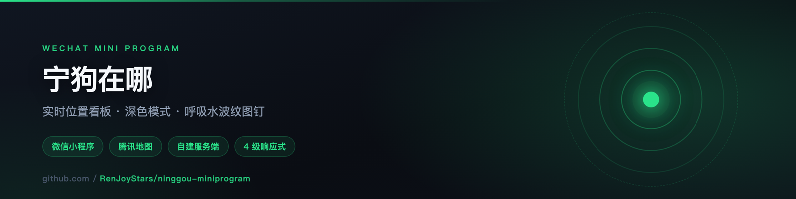

一个**只读的位置看板**小程序。手机把位置上报给你自己的服务器，这里把它画在地图上 —— 不做追踪、不要后台定位权限、不采集任何多余的东西。

配套的 iOS 端与网页版不在本仓库。

---

## 界面

- **水波纹呼吸图钉**：8 帧动画，缓慢呼吸，一眼能找到那个点
- **缩放平滑防抖**：连点加减号不会抖动，地图跟着手指走
- **深色 / 浅色自适应**：跟随微信主题切换，卡片、页脚、控件全部换色
- **平板与折叠屏适配**：地图铺满宽度；矮屏（如华为折叠屏外屏）自动切紧凑布局
- **下拉刷新**：手动拉一次最新位置
- **无感加载**：只读拉取，不申请高敏感度权限

---

## 快速开始

```sh
# 1. 微信开发者工具 → 导入项目 → 选这个目录
# 2. 改两处配置：
```

| 改哪里 | 改成什么 |
|---|---|
| `app.js` → `globalData.serverUrl` | 你自己的接口地址 |
| `project.config.json` → `appid` | 你自己的小程序 AppID |

编译预览即可。**没有后端也能跑起来看界面**，只是地图上没有点。

---

## 服务端接口

只需要一个只读接口：

```
GET /api/latest
```

期望返回：

```json
{
  "code": 0,
  "data": {
    "timestamp": "2026-11-19 09:00:00",
    "location": { "latitude": 28.2216, "longitude": 113.1198 }
  }
}
```

坐标按 **GCJ-02**（火星坐标系）给，腾讯地图直接用。如果你上游拿到的是 WGS-84，**必须先在服务端转好再下发**，否则点会偏几百米。

---

## 目录结构

```
app.js / app.json / app.wxss   全局入口与深色主题声明
theme.json                     深色模式变量表（darkmode 必需）
pages/home/
  home.wxml                    地图 + cover-view 缩放条 + 页脚
  home.wxss                    两套主题变量、5 档响应式
  home.js                      主题监听、图钉构建、刷新逻辑
images/                        图钉、图标素材（浅/深两套）
docs/banner.png                仓库横幅（不参与打包）
```

---

## ⚠️ 关于「深色地图」，先把话说清楚

这部分是踩了整整两天坑换来的。如果你也想在小程序里做深色地图，先看这里，能省你两天。

**小程序的地图组件没有暗色 API。** 想让它变黑，只有三条路，而其中两条是死的：

| 做法 | 结果 |
|---|---|
| 给 `<map>` 加 CSS 滤镜（`filter: invert()`） | ❌ **真机完全无效**。微信基础库不支持对原生组件应用滤镜，只在开发者工具里"伪生效" |
| 用 `cover-view` 蒙一层半透明黑 | ❌ 地图跟着一起糊，看着像蒙了层沙 |
| 微信「地图个性化样式」 | ✅ 唯一真解法，**¥399 起/年**，需要 `subkey` + `layer-style`，且 `subkey` 不支持动态切换 |

那为什么配置 `darkmode: true` 之后，地图看起来确实暗了一点？

**那是微信自己在 iOS 上把地图压暗了约 20%**（实测底图亮度 245 → 200），不是你的代码干的。同一个包在**安卓上地图仍然是纯白**。

这条还牵出一个绕不开的约束：

> `wx.getAppBaseInfo().theme` 的官方说明是「全局配置 `darkmode: true` 时才能获取，否则为 undefined」。
> 也就是说 —— **「地图纯白」和「卡片深色」是同一个开关的两面，拆不开。**
> 想要地图纯白，就得关掉 `darkmode`，框架也一起变浅色。

本项目选择了**深色框架 + iOS 浅灰地图**：跨端不完全一致，但视觉上成立。如果你要两端都是黑地图，只有付费那一条路。

---

## 适配说明

| 场景 | 处理 |
|---|---|
| iPad / 平板 | 地图横向铺满，无左右留白 |
| 华为折叠屏外屏（矮屏） | `layout-mini` 紧凑档：缩小页脚、压紧控件 |
| 小屏手机 | 常规档，控件贴底 |

缩放条必须用 `<cover-view>` 放在 `<map>` **内部**、且**在地图遮罩层之后**。原生组件的层级规则和普通 `view` 相反 —— 放外面会被地图整体盖住，这也是缩放键"失灵"最常见的原因。

---

## 许可

MIT。图钉与图标素材为本项目原创，可随代码一同使用。
